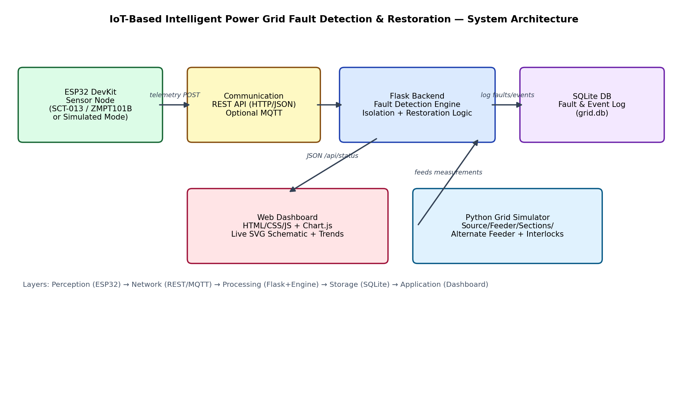
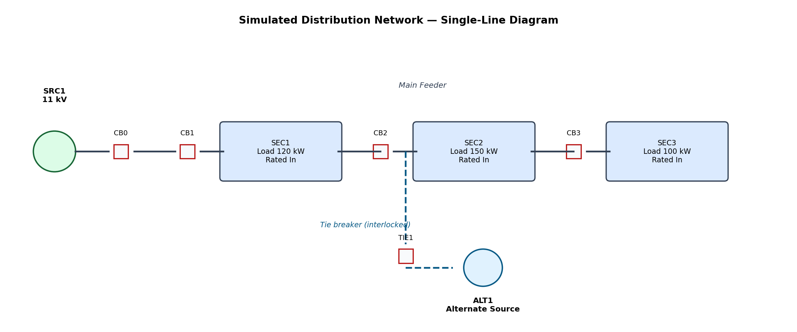
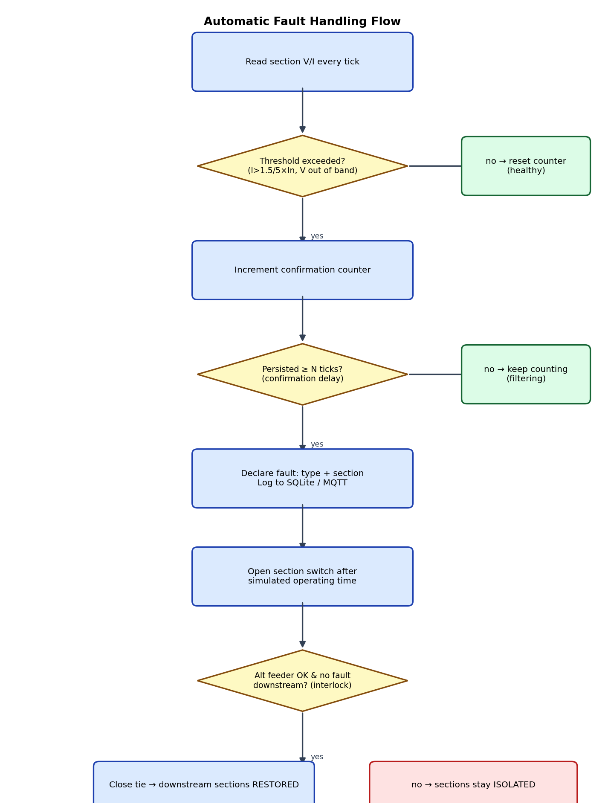

# Project Report — IoT-Based Intelligent Power Grid Fault Detection and Automatic Restoration System

## 1. Abstract
This project presents an IoT-enabled power distribution grid prototype that
continuously monitors distribution sections, detects electrical faults using
threshold-based protection logic with confirmation filtering, automatically
isolates the faulty section using simulated circuit breakers, and restores
power to healthy sections through an alternate feeder once all safety
interlocks are satisfied. All electrical measurements are simulated and
clearly labeled as such.

## 2. Block Diagram

## 3. Power Circuit — Single-Line Diagram

## 4. Fault-Handling Flowchart

## 5. Methodology Summary
1. **Measurement:** simulated V/I per section each tick (with noise).
2. **Detection:** per-unit threshold comparison with N-tick confirmation delay.
3. **Classification:** short-circuit (I > 5×In), overcurrent (I > 1.5×In),
   undervoltage (V < 0.85×Un), overvoltage (V > 1.15×Un).
4. **Isolation:** open the faulty section's switch after a simulated operating
   time; upstream sections remain energized.
5. **Restoration:** tie breaker closes only if the alternate feeder is healthy
   and no fault exists downstream (interlock); downstream sections transition
   RESTORING → RESTORED.
6. **Repair:** clearing the fault re-closes the section and returns the grid
   to normal radial topology.

## 6. Results (automated test verification)
See `tests/` — 23 unit tests covering detection, isolation, restoration,
interlocks, sensor failure and the REST API.
